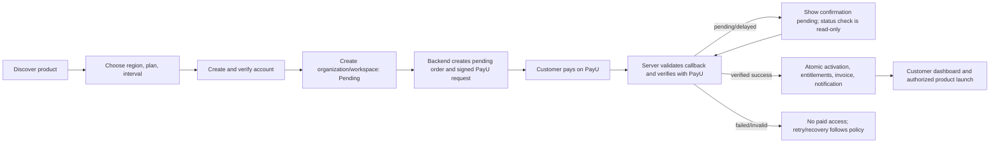

# MYR SaaS Platform Specification — Current-State Analysis and Work Plan

- **Specification reviewed:** `MYR_SaaS_Platform_Developer_Specification.pdf`, version 1.0 (October 2026, 24 pages).
- **Repository reviewed:** current React/Vite client and `server/index.mjs` API.
- **Purpose:** distinguish the requested SaaS platform from the existing corporate site/storefront, record current capabilities, and define changes required by the specification.
- **Status:** baseline audit updated as implementation progressed; see the phase tracker and current milestone ledger below for current delivery status.

## 1. Executive assessment

The current application is a corporate marketing website and one-time commerce storefront. It has useful pieces to preserve: a React site with extensive MYR content, client routing, account registration/login, email verification and recovery flows, a role-aware admin/manager UI, product catalog, cart, customer order history, support submissions/replies, and a PayU one-time payment flow with server-side response-hash and provider-status checks.

It is **not yet the multi-product SaaS subscription platform described in the PDF**. There is no organization/tenant model, product workspace, subscription catalog/lifecycle, plan entitlement enforcement, PayU adapter, product launcher, invoice/subscription billing area, multi-tenant product modules, or full ticketing/knowledge/AI support platform. Existing `/crm-*` routes are demo/marketing panel pages, not customer-isolated CRM product workspaces. The current app must retain its corporate website and storefront while a separate SaaS application experience and modular platform backend are added.

The PDF explicitly requires an audit and approved plan before development. This document supplies the repository-side audit and implementation plan, but MYR still needs to approve target architecture, estimates/cost, and provider dependencies before the build is treated as authorized.

## 2. Existing system audit

### Stack and layout

- Frontend: React 19, TypeScript 6, Vite 8, React Router 7, Tailwind 4.
- Backend: custom Node.js HTTP server in `server/index.mjs`.
- Persistence: MongoDB document containing a whole application-state object in production; local SQLite/JSON state for development; optional PostgreSQL remains a legacy whole-state backend. SaaS now follows the MongoDB-backed app persistence path, not a separate relational database.
- Existing routes cover MYR marketing pages, a WooCommerce-style catalog/store, checkout/account, admin/manager, policy pages, and demo CRM panel pages.
- Existing infrastructure/config has PayU merchant settings, Resend email settings, app/site origins, and backup configuration. No worker/queue setup was found.

### Existing features to preserve and reuse where appropriate

- Marketing site, SEO metadata, route inventory, legal/content pages, public service and product pages.
- Customer login/register, password hashing, session cookie, email verification, password recovery, account role checks.
- Product catalog and admin price adjustment for the existing one-time store.
- Cart, order history, order cancellation while unpaid, PayU hosted checkout, server-side response-hash and payment-status verification.
- Customer support request and reply UI, admin/manager inbox and status updates, audit-event display.
- Admin/manager separation for existing site operations.

These features do not automatically satisfy SaaS requirements. For example, a paid storefront order is not a subscription; an account role is not organization membership; a support inbox entry is not a complete ticket workflow; and a demo CRM panel is not the CRM product.

### Current-state limitations material to the target

- Account records are individual users without organizations, memberships, tenant-scoped product records, or owner/member billing permissions.
- Data is persisted as one application-state object rather than normalized platform/product tables with foreign keys and database constraints.
- No demonstrated tenant isolation boundary exists because the target organization model is absent.
- Existing PayU checkout covers one-time INR order payment; it does not implement subscription renewal, recurring mandates, provider-independent subscription billing, or idempotent subscription activation.
- Email verification is configurable and defaults off; the SaaS journey requires verification before a workspace becomes entitled.
- No MFA flow is evident; admin MFA is mandatory in the specification.
- No plan/entitlement service or server-enforced product limits exist.
- Account page shows purchases and support requests, not an organization/product launcher, members, subscriptions, invoices, billing settings, or usage.
- Admin panel covers existing store operations, not configurable SaaS products/plans/limits/promos/regions, subscription operations, provider events/reconciliation, support administration, knowledge review, or subscription analytics.
- No PayU merchant eligibility confirmation, tax/accounting approval, live product URLs, legal subscription terms, operational staging/rollback evidence, or tested backup restore is established by this repository review.

## 3. Requirement-to-current-state map

| Specification area | Current state | Required change |
|---|---|---|
| Public discovery and product marketing | Extensive company/service/store pages exist; target Coaching ERP/CRM/HRM SaaS catalog routes and admin-driven product pages do not | Add product discovery, dedicated SaaS product pages, all-products pricing, product/region/interval selectors, verified-feature content, real screenshots/demo, region/currency selection, SaaS SEO/legal/status/help links. Preserve existing corporate service pages and store. |
| Account and organization setup | Individual user accounts; no org/workspace | Add verified account lifecycle, organizations, owner/member records, invitations/roles, workspace state, and account settings. |
| Product/plan catalog | Existing physical/service catalog and editable store prices | Add configurable SaaS products, plans, intervals, regions, currencies, trials, limits, features, add-ons/promos; no plan prices/limits hard-coded in UI. |
| Checkout | One-time cart/order checkout via PayU | Add product-specific subscription checkout with region, plan, interval, tax/fees, trial and renewal/cancellation disclosure, promo validation, account/workspace steps, pending order state, and verified PayU handoff. |
| Payments | PayU hosted order flow with response-hash/provider check | Add provider-independent subscription billing only after account capabilities and formulas are confirmed in current PayU documentation. Keep secrets server-side; persist transactions before redirect; verify callback hashes and server-side payment status; compare transaction/order/amount/currency; handle delayed, duplicate, failed, and pending events idempotently. |
| Subscription lifecycle | None | Add trialing, active, payment failed/past due, cancellation scheduled, suspended, cancelled, expired, abandoned transitions; renewal retries/grace, cancellation/reactivation/change plan, scheduled reconciliation, audit trails, and no automatic data deletion. |
| Entitlements and limits | None | Add per-organization, per-product entitlements derived from subscription; every product API checks tenant ownership, active state/grace policy and plan limit on the backend. |
| Product experience | `/crm-*` pages are demo panel UI; no Coaching ERP/CRM/HRM launch integration | Build actual product modules or integrations with strict module boundaries; add entitlement-gated launch endpoint and product launcher. Advertise only functioning verified features. |
| Customer dashboard | `/my-account/` handles orders/cart/support | Add organization profile, product launcher, each product subscription/status, plan/usage, members, billing history/invoices, payment/cancellation/change-plan actions, notifications, help/tickets. |
| Support and AI | Basic support requests/replies and admin inbox; static help articles | Add formal tickets and workflow, product/plan metadata, assignment/priority, customer/agent messages, private notes, notifications, validated secure attachments; approved knowledge management; grounded AI with article citations, same API authorization, human handover and usage/review controls. AI financial actions prohibited. |
| Admin and analytics | Existing admin manages users/catalog prices/orders/inbox/audit | Add mandatory admin MFA and role permissions; configurable SaaS catalog/plans/limits/trials/regions/promos; organization/subscription search; reason-required suspend/restore; billing/events/refunds where supported; reconciliation; knowledge/support administration; accurate MRR/funnel/churn/renewal/support analytics by currency. |
| Data architecture | Whole-state document/JSONB model, with local SQLite option | Use the existing MongoDB platform and introduce tenant-scoped SaaS data structures for users, organizations/members, products/plans, subscriptions/items, entitlements, transactions/events, invoices, tickets/messages/attachments, articles, notifications, and audit logs. Enforce uniqueness and tenant scoping in repository operations and MongoDB indexes. Keep SaaS persistence aligned with MongoDB; avoid introducing a second required database. |
| Security/privacy | Some password/session/rate-limit/payment controls exist; target controls incomplete | Add tenant-scoped repository boundary and MongoDB indexes, MFA, role authorization, session revoke/expiry, stronger rate limiting/headers, secure uploads, secret handling, audit and monitoring. Review DPDP/student/children data, retention, deletion, DPA, privacy and country tax obligations with qualified owners. |
| Internationalization/tax | INR store pricing; no SaaS region/currency/tax selection | Start with one confirmed product/plan/currency for M2. Show only payment currencies/methods eligible for the MYR PayU account. Add regional price/tax configuration, explicit order total and renewal/tax disclosure, UTC timestamps with local display, GST-compliant invoice requirements; obtain accounting review before international sales. |
| Operations and delivery | Current app has env/config and backup script, but target staging/restore/rollback evidence not established | Establish staging matching production, HTTPS/reverse proxy, private database, worker/queue, monitoring/alerts, health/ready endpoints, encrypted off-server backup and demonstrated restore, deployment/rollback runbooks. No production migration before acceptance. |
| Documentation and evidence | Existing build/smoke scripts; no SaaS API/schema/acceptance evidence | Publish architecture, OpenAPI, MongoDB data model/indexes, env/deployment, payment/lifecycle, backup/restore, rollback, security/tenant tests and acceptance evidence. |

## 4. Target customer and payment workflow

Required lifecycle: pending checkout → pending verification → trialing or active → payment failed/past due (grace policy) → active on recovery, cancellation scheduled until period end, or suspended/cancelled/expired. Each transition is auditable. Duplicate callbacks and retries must not create duplicate charges, subscriptions, entitlements, or invoices.

## 5. Phase-by-phase execution plan

The durable task-by-task checklist is maintained in `SAAS-PHASE-PLAN.md`. The sections below explain each phase; status reflects repository implementation only, and a build passing is not a production acceptance pass.

### Phase 0 — Audit and approvals (gate before commercial configuration)

**Status: repository audit and plan recorded; MYR approvals/provider answers remain pending.**

- MYR reviews and approves this audit, target architecture, delivery estimate/cost, data migration plan, risks, and feature-branch/PR approach.
- Confirm PayU account type, enabled countries/currencies, recurring support, mandates/consent/pre-debit notices, webhook/signature/retry behavior, refunds, fees and settlement in writing.
- Choose the first product, plan, INR price, tax treatment, trial policy, retention period, product launch URL/integration, and legal copy. Confirm no unsupported product claims.
- Select MongoDB deployment, queue/worker, email, and object-storage providers; decide whether existing storefront accounts/data migrate or remain on the corporate app initially.

### Phase 1 — Foundation

**Status: foundation code implemented; staging/database and owner-approved product-slice acceptance remain open.**

- Preserve the corporate site and storefront while introducing a distinct SaaS app area/domain boundary and API module boundaries.
- Build MongoDB-backed tenant-scoped persistence for user, organization, membership, catalog, plan, subscription, entitlement, audit and notification core.
- Require verified email for workspace activation; implement organization owner/member roles, invitations, admin MFA, session management, and tenant isolation.
- Make catalog/plan/limit/region/trial data admin-configurable; build one product/plan/currency end to end as the first vertical slice.
- Add backend entitlement/limit middleware and explicit tenant isolation tests.

**Implemented so far:** MongoDB-persisted SaaS foundation records within the existing application state store; draft product identities; public catalog; separate SaaS single-use email verification; organization and membership APIs; invitation/role controls; membership-scoped entitlements; TOTP administrator MFA and gated product/plan administration; `/software/`, `/pricing/`, and `/workspace/` pages; API documentation. Build passes. MongoDB runtime behavior remains unverified until a connected development/staging MongoDB is exercised.

**Remaining:** MongoDB staging/runtime evidence, explicit tenant-isolation acceptance, and one owner-approved product/plan vertical slice. No product price or capability has been invented or published.

### Phase 2 — Commercial journey

**Status: INR hosted-checkout foundation implemented; merchant acceptance, tax and recurring mandate workflow remain open.**

- Implemented PayU India hosted INR checkout initiation with server-calculated totals and pending order persisted before handoff.
- Implemented return/webhook reverse hash validation, PayU Verify Payment call, amount/merchant transaction matching, event idempotency, subscription/entitlement/invoice activation, status API and admin reconciliation.
- Added customer checkout total review, invoice records, and term-end cancellation. Current billing is manual renewal; no mandate/autorenewal is claimed.
- Remaining: merchant account and webhook acceptance, approved tax/legal settings, PayU recurring mandate and pre-debit integration, retry/grace/change plan/worker, product launch, and M2 staging evidence.

### Phase 3 — Customer experience

**Status: platform customer journey, initial tenant-scoped product slices, record usage counters and billing profile are implemented; full product workflows and M3 approval remain open.**

- Product discovery/pricing reads active products and enabled plans from the approved server catalog; plan limits, region codes and term are shown.
- Checkout now lists billing-authorized organizations, discloses the one-time manual renewal, and obtains tax/total from the server.
- Workspace now shows subscriptions, cancellation/reversal, invoices, notifications, configured entitlements/limits and a server-authorized product launch action.
- The launch API checks active membership, product, current subscription and entitlement before returning the configured HTTPS destination.
- Added initial entitlement-gated tenant-scoped records: CRM lead stage/follow-up; HRM employee onboarding/status; Coaching ERP minimal admission/program/batch status. Sensitive student profile data is not collected by this initial slice.
- The workspace includes record usage counts and configured limits for the initial leads/employees/students records; other seat, branch, storage, appointment and module-specific usage counters are not implemented.
- Remaining product workflows from the spec include ERP fees/receipts, attendance, exams/results, parent/student access, branches/online learning; CRM assignment, appointments/reports; and HRM attendance/shifts/leave/documents/reports.
- Organization billing profile fields and invoice snapshots are implemented, but qualified invoice/tax review, catalog breadth, regional currency eligibility and publication approvals remain open.

### Phase 4 — Support

**Status: core ticket and knowledge workflow implemented; generative AI and M4 staging acceptance remain open.**

- Added tenant-scoped tickets and threads with the specified states, priority, assignment, customer/agent messages, product context, app notifications and audit trail. Private notes are excluded from every customer-facing response.
- Added private PDF/PNG/JPEG/plain-text attachments with file signature checks, a 3 MB per-file limit, private filesystem storage and organization-member-scoped downloads.
- Added draft/review/published/archived help articles, product scope and search over published content only.
- Added a disclosed extractive helper that returns exact approved article excerpts and citations, stores only minimized usage metadata, and provides a human handover action. It performs no financial actions and does not retrieve private account records.
- MFA-gated admin tools provide ticket assignment/status/priority, private notes, knowledge review, queue metrics, and assistant usage review/flagging.
- Generative AI provider/model, private object storage, attachment retention/deletion, and M4 staging evidence remain open. Optional Resend ticket notices are implemented but require `RESEND_API_KEY`, `EMAIL_FROM`, and optional `SAAS_SUPPORT_EMAIL` configuration. The current extractive helper is not represented as generative AI.

### Phase 5 — Production readiness

**Status: not started.**

- Complete security/privacy and qualified tax/legal reviews; rate limiting, headers, dependency review, monitoring, alerts and health checks.
- Demonstrate encrypted backup restoration; establish staging parity and rollback procedure.
- Run mandatory acceptance suite and record evidence; deploy to staging, fix findings, then seek production release approval.

## 6. Acceptance and release gates

Use the 32 PDF tests as the release checklist. Minimum gates:

1. **M1 — Plan approved:** audit, target architecture, schema/migration, PayU dependencies, estimates/cost, and risks approved.
2. **M2 — First paid staging journey:** one product/plan/currency; verified registration; organization; verified PayU payment; automatic subscription/entitlement/invoice; product launches from dashboard.
3. **M3 — Catalog breadth:** Coaching ERP, CRM, HRM plans; INR live; USD/GBP only after provider and tax approval.
4. **M4 — Support/AI staging:** ticket lifecycle, secure replies/attachments, reviewed knowledge, grounded AI, safe escalation and admin controls.
5. **M5 — Production readiness:** all 32 acceptance cases pass with dated evidence; backup restore and rollback demonstrated; legal policies available.

No production migration should happen before staging acceptance and a documented rollback. Keep existing corporate functionality available throughout the migration.

### Current milestone status

| Milestone | Status | Evidence / remaining |
|---|---|---|
| M1 Audit and plan approved | In progress | Repository audit and work plan recorded here; MYR approval, estimates/cost, provider answers, product selection and deployment decisions remain. |
| M2 First paid journey on staging | Not started | Provider-neutral adapter, INR PayU integration code, payment activation, invoice records and product launch authorization are implemented. Staging credentials, merchant acceptance, approved product/plan/tax settings, and end-to-end evidence remain. |
| M3 All products and currencies | Not started | Products seeded as drafts; no prices/limits/currency eligibility published. |
| M4 Support and AI live on staging | In progress | SaaS tickets, knowledge, extractive help, handover and MFA-gated support administration are implemented. Approved generative AI provider/model, private object storage and retention policy, and staging acceptance evidence remain. |
| M5 Production ready | Not started | Acceptance evidence, restore demonstration, staging parity, rollback, and legal publication remain. |

## 7. Decisions and open questions for MYR

- Which one product and plan should be the M2 vertical slice, and where does that product actually run today?
- Is PayU enabled for the MYR merchant account, and which currencies/payment methods/recurring mandates are approved?
- Should SaaS remain in this React/Node/MongoDB deployment or become a separate application while the corporate site remains unchanged?
- What are the approved product features, plan names/prices/limits/trials, tax rules, retention period, and support service hours?
- Which domain/subdomain and hosting/database/queue/object-storage/email services are approved? Domain availability and account capability must be checked by MYR.
- Who provides qualified accounting/legal decisions for GST, international tax, DPDP/student data, cancellation/refund, DPA, and recurring mandates?
- What delivery estimates/cost and staffing are approved? The repository and PDF alone do not establish these values.

## 8. Specification interpretation note

Instructions inside the PDF are treated as product requirements and acceptance criteria, not as authorization to make production, payment-provider, domain, or infrastructure changes. Its explicit “audit first” rule is honored here. The PDF's proposed PostgreSQL persistence is adapted to the user's stated MongoDB deployment; tenant isolation and data integrity requirements still apply and must be enforced by the MongoDB persistence model.
